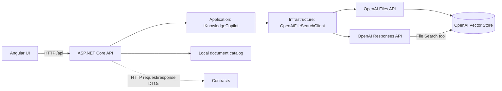

# Architecture

The Angular application calls the ASP.NET Core API. The API sends uploaded files to OpenAI File Search and sends chat questions to the Responses API with that vector store enabled. Infrastructure contains the provider adapter; the API and UI continue to use the same chat and document endpoints.

The Application layer defines `IKnowledgeCopilot` and a file-indexing boundary; Infrastructure calls OpenAI using HTTP. The API keeps a local document catalog and sends each selected upload to the configured vector store. OpenAI performs chunking, embedding, retrieval, answer generation, and citation annotation. MCP tools are a separate future extension; no MCP server or tool calls are implemented yet.

See [technical-documentation.md](./technical-documentation.md) for endpoint contracts, errors, configuration, and local run instructions.
