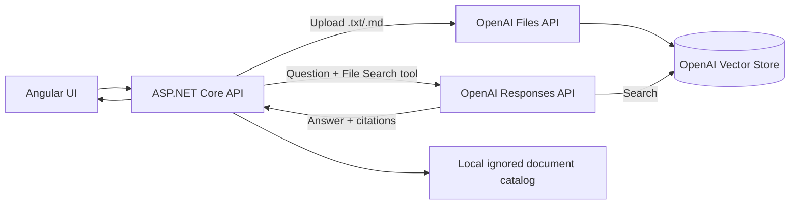

# Enterprise Knowledge Copilot — Technical Documentation

## Overview

Enterprise Knowledge Copilot is an Angular 22 UI with a .NET 8 API. The API uses the OpenAI Responses API and hosted File Search for grounded document Q&A. OpenAI handles file chunking, embeddings, semantic and keyword retrieval, and answer generation from a configured vector store.

## Request flow



- The API uploads documents selected by the user to the configured OpenAI vector store.
- A local catalog under `.local/knowledge-base/` retains a development copy and document metadata.
- The Responses API searches the vector store, generates a grounded answer, and returns file citations.
- Instructions treat document text as untrusted and ask the model to refuse unsupported answers.
- MCP is not implemented yet. It can later expose app actions as tools; it is separate from the File Search RAG flow.

## Run locally

In PowerShell, set the API key and vector store ID in the terminal that will run the API. Do not commit or send the key to anyone.

```powershell
$env:OPENAI_API_KEY = 'your-api-key'
$env:OPENAI_VECTOR_STORE_ID = 'vs_your-vector-store-id'
$env:OPENAI_MODEL = 'gpt-5.4-mini'
dotnet run --project src/EnterpriseKnowledgeCopilot.Api --launch-profile http
```

The model defaults to `gpt-5.4-mini`. In another terminal:

```powershell
Set-Location frontend
npm.cmd start
```

The API listens at `http://localhost:5050`; Angular runs at `http://localhost:4200`. Create a vector store once with `scripts/create-openai-vector-store.ps1`; it requires `OPENAI_API_KEY` in that PowerShell session and prints the ID to configure.

## HTTP endpoints

### `GET /api/health`

Returns `200 OK` and `{ "status": "healthy" }`. This checks the API process only, not OpenAI connectivity.

### `GET /api/documents`

Returns local catalog summaries. Older documents previously uploaded in local mode are marked `indexedInOpenAi: false`; upload them again to index remotely.

### `POST /api/documents`

Accepts multipart form data with a `file` field. Supported extensions are `.txt` and `.md`, maximum size 5 MB. The API sends the selected file to OpenAI for indexing before adding it to the local catalog.

### `POST /api/chat`

Accepts JSON with a `question` property, 3–2,000 characters.

```json
{ "question": "What is the approval process?" }
```

Returns `answer`, `isGrounded`, and `citations`. Citation excerpts are taken from OpenAI File Search results.

## Configuration

| Variable | Purpose |
| --- | --- |
| `OPENAI_API_KEY` | API credential; keep it in a local environment variable or secret store. |
| `OPENAI_VECTOR_STORE_ID` | Existing OpenAI vector store used for uploads and retrieval. |
| `OPENAI_MODEL` | Responses API model; defaults to `gpt-5.4-mini`. |

The Responses API and File Search charges are separate from a ChatGPT subscription. OpenAI pricing includes 1 GB of vector-store storage and usage-based model and File Search charges. Review the [current pricing](https://developers.openai.com/api/docs/pricing) before uploading. Uploaded files are transmitted to OpenAI; do not use confidential material in this portfolio demo.

## Errors and limitations

- Missing API key, vector store ID, or model settings return `503 Service Unavailable`.
- OpenAI API failures return a generic `502 Bad Gateway`; provider response bodies and credentials are not exposed.
- Invalid chat request bodies return `400 Bad Request`.
- The browser upload flow currently accepts only text and Markdown files, despite File Search supporting additional formats.
- The API has no user authentication, per-user vector store isolation, document deletion workflow, or production rate limiting. The local development configuration is not production-ready.
- MCP tools, Azure hosting, and automated infrastructure deployment are not included in this milestone.

